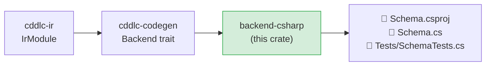

# backend-csharp

Generates a complete C# / .NET 8 library — a `.csproj`, source files, and an xUnit test
project — from an `IrModule`.  The generated code uses `System.Formats.Cbor` (inbox in
.NET 6+) for CBOR and `System.Text.Json` for JSON.

## Position in the pipeline



## Generated output layout

```
<output>/
  <Module>.csproj          # SDK-style project targeting net8.0
  <Module>.cs              # all types with encode/decode methods
  Tests/
    <Module>Tests.csproj   # xUnit test project
    <Module>Tests.cs       # roundtrip test for every type
```

## What is generated per IR type

### Structs

```csharp
public sealed class Device
{
    public string  Id     { get; set; } = "";
    public bool    Active { get; set; }
    public string? Label  { get; set; }    // nullable optional

    public byte[] EncodeCbor()                              { … }
    public static Device DecodeCbor(ReadOnlySpan<byte> data) { … }

    public string EncodeJson()                              { … }
    public static Device DecodeJson(string json)            { … }
}
```

- Optional fields use C# nullable reference types (`string?`, `int?`).
- CBOR encode uses `CborWriter`; decode uses `CborReader`.
- JSON uses `System.Text.Json` serialisation.

### Enums

```csharp
public enum Status { Ok, Warn, Error }
```

String enums encode as CBOR text strings; integer enums encode as CBOR integers.

### Arrays

```csharp
public List<float> Items { get; set; } = new();
// encoded as a definite-length CBOR array
```

### Aliases

```csharp
// Transparent alias — generated as a using directive or documented typedef
```

## Supported serialization formats

| `--format` | Generated code |
|---|---|
| `cbor` | `System.Formats.Cbor.CborWriter` / `CborReader` |
| `json` | `System.Text.Json.JsonSerializer` |

## dCBOR support

When `--dcbor` is passed, CBOR map writes sort keys before encoding, producing
deterministic output compatible with COSE and similar protocols.

## Build and test

```bash
cd <output>/
dotnet build
dotnet test Tests/
```

Requires .NET 8 SDK or later.

## Known gaps and future enhancements

- **Partial constraint validation**: `.size` and numeric range constraints emit
  `ArgumentException` guards; `.regexp` constraints reach the IR but are not emitted in
  the generated code.
- **No XML doc comments**: `@doc` pragma text is not rendered as `/// <summary>` lines.
- **No NuGet packaging**: no `.nuspec` or `PackageReference` publish configuration.
- **`System.Formats.Cbor` requirement**: requires .NET 6+; no fallback for .NET Framework
  or older .NET Core targets.
- **Mutable properties**: all properties use `{ get; set; }`; a `--immutable` option for
  `init`-only / `required` members would be more idiomatic for C# 11+.
- **No source generators**: encode/decode is explicit method bodies; a Roslyn source
  generator approach would allow incremental SDK-integrated regeneration.

## License

MIT OR Apache-2.0
